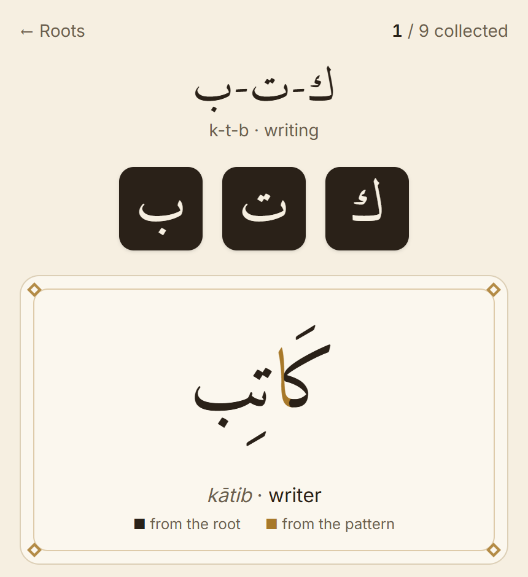

# Wazn · وَزْن

Most Arabic words are built from a three-letter **root** poured into a **pattern** (a *wazn*).
The root ك-ت-ب carries the idea of writing; put it into the pattern فَاعِل ("the doer") and you get
كَاتِب, *writer*. Put it into مَفْعَل ("the place") and you get مَكْتَب, *office*.

Wazn is a small web game for Arabic learners that makes this visible. You pick a root, tap a pattern,
and watch the root's letters fly into the pattern's slots and join into a real word, coloured so you can
see which letters came from the root and which the pattern added. Words go into your collection,
collecting three from a root unlocks the next one, and a quiz tests you on the words you've collected.

**Live demo:** https://abdulwaarith0.github.io/wazn/



## Features

- **Root Workshop.** Every pattern for the root is shown; patterns with no common word for that root are
  greyed out and explain why when tapped.
- **15 roots**, unlocked one at a time, including weak and doubled roots (قَوَلَ → قالَ) where letters
  change. Those form in two steps: first the regular shape, then the real word with the rule that changed it.
- **Collection** of every word you've formed, grouped by root, with a gold seal for a finished root.
- **Quiz** built only from words you've collected: pick a word's root letters from a tray, or place a
  root's letters into a pattern.
- **Beginner / Grammar switch.** Beginner names patterns in plain English ("the doer"); Grammar uses the
  real terms (اسم الفاعل, Form III). Switching changes labels only, never progress.
- Progress is saved in the browser, and the animation respects the reduced-motion setting.

## How it works

The interesting part is getting Arabic to behave while it animates.

**Splitting a word without breaking it** ([`src/lib/arabic.ts`](src/lib/arabic.ts)).
Arabic letters change shape depending on whether they join to their neighbours, and vowel marks are
separate code points. To animate a word letter by letter, `letters()` splits it into letters that each
carry their own marks, and `joinFlags()` works out which letters connect (some, like ا د ر و, never join
forward). `withJoiners()` then wraps a letter drawn on its own in zero-width joiners, so it still takes the
shape it has inside the word. `changedLetters()` uses a longest-common-subsequence match to find which
letters differ between a weak root's regular form and the real word.

**The letter flight** ([`src/components/WordAssembly.tsx`](src/components/WordAssembly.tsx)).
A FLIP animation: measure the root tile and the target slot, place a flyer on the slot, offset it back to
the tile, and animate the offset to zero along an arc. On landing it squashes, knocks out the ف/ع/ل
placeholder, and cross-fades from the letter's standalone shape to its joined shape, then the pieces fade
into the finished, colour-coded word. It waits for the Arabic font to load before measuring, ignores taps
mid-animation, and with reduced motion on it simply fades the word in.

**Data, not code, decides what's a real word** ([`src/data/`](src/data)).
Each word records its root, its pattern and a `roles` string marking every letter as root (`r`) or
pattern (`p`). That one string drives the placeholders, the colouring and the animation, and the tests
check it against the word (every `r` letter must spell the root).

**Progress that can't crash the app** ([`src/lib/storage.ts`](src/lib/storage.ts), [`src/lib/progress.ts`](src/lib/progress.ts)).
Storage falls back to memory when `localStorage` is blocked (private browsing, locked-down school
devices), and saved progress is validated on load: corrupted data or unknown word ids start fresh
instead of throwing.

## Project structure

```
src/
  screens/      Intro, Roots, Workshop, Collection, Quiz
  components/   WordAssembly (the animation), tiles, word card, reward/unlock/seal moments
  lib/          arabic (letter splitting and joining), progress, storage, quiz, labels, audio
  hooks/        useProgress (saved state), useAudio
  data/         roots, patterns and words
tests/          Vitest unit tests for arabic, words, progress, quiz, labels, audio
```

## Running it locally

Needs Node 22.

```sh
npm ci
npm run dev      # http://localhost:5173
npm test         # unit tests
npm run lint
npm run build    # production build into dist/
```

Every push to `master` runs lint, tests and the build, then deploys to GitHub Pages
([`.github/workflows/deploy.yml`](.github/workflows/deploy.yml)).

## Built with

React 19, TypeScript, Vite, Tailwind CSS 4, Motion, Vitest. Arabic is set in
[Amiri](https://fonts.google.com/specimen/Amiri), Latin in Inter.
